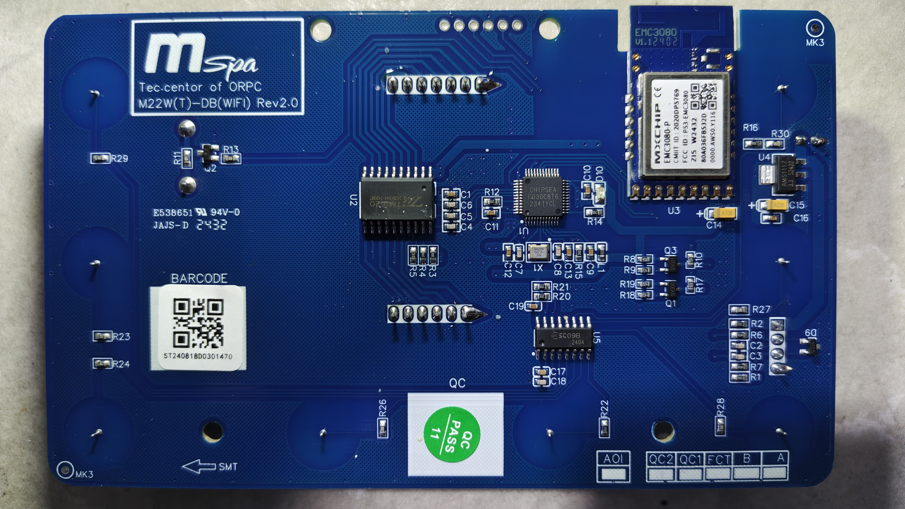

# MSpa ESP32 controller

[Čeština](README.md) | [Original French documentation](README.fr.md)

This is a copy of [EtienneESP32/MSPA-ESP32-EEDOMUS](https://github.com/EtienneESP32/MSPA-ESP32-EEDOMUS). The project places an ESP32 between the original MSpa control panel and the spa controller, relaying the panel's UART traffic and providing local ESPHome/Home Assistant control. It also includes a sniffer and simulator. The original project targets a Tribeca D-series spa; compatibility with F-TR062W and board M22W(T)-DB(WIFI) Rev2.0 has not been established.

**Do not assume the wire colours, pinout, voltage, or protocol of a different spa.** Verify them before wiring. The original panel's operation when the ESP32 loses power or freezes is not established; the active bridge alone does not guarantee a hardware bypass. Do not bypass the spa's safety protections.

## Components

- [Controller](esphome/mspa-controller.yaml): UART bridge, Home Assistant entities and optional Eedomus HTTP integration.
- [Sniffer](esphome/mspa-sniffer.yaml): inspect the bus before attempting active control.
- [Simulator](esphome/mspa-simulator.yaml): a test bench for development.
- [Hardware and wiring](docs/hardware.en.md): upstream reference wiring and F-TR062W observations.

## Getting started

1. Identify the connector, supply voltage and signal levels. Passively capture both data directions and compare the frames to the project's protocol before connecting a transmitter.
2. Install [ESPHome](https://esphome.io/). Copy `esphome/secrets.yaml.example` to `esphome/secrets.yaml`, fill in Wi-Fi and recovery AP credentials, and do not commit the secrets file. For Home Assistant without Eedomus, set `eedomus_enabled: "false"`; the configuration may still require the other secret keys to exist.
3. After compatibility and wiring are verified, build and flash with `py -m esphome run esphome/mspa-controller.yaml`.
4. Add the device using Home Assistant's ESPHome integration. Test the original panel, status reporting, each command, and behaviour on ESP32, Wi-Fi and HA failures before relying on it.

The original French documentation and source code are preserved. See [LICENSE](LICENSE) for attribution and license terms.

## Architecture

The controller sits between the original control panel and spa controller. It relays panel commands unless the optional keypad lock is enabled, reads spa status, and can insert commands from the automation interface. The upstream author states that filter and heater indicators wait for reported state, and the firmware limits the target temperature to 40 °C. These are upstream claims and are not proof of compatibility or safety on every spa.

The simulator reproduces the communications used for development, while the sniffer observes frames without taking control. The original project also supports an Eedomus dashboard and HTTP state updates; see its [Eedomus setup](docs/config_eedomus.md) for details.

## Owner's PCB

The board is marked M22W(T)-DB(WIFI) Rev2.0. See the [hardware guide](docs/hardware.en.md) for the connector photograph and measured ground pin.

## Troubleshooting and support

The upstream [troubleshooting guide](docs/troubleshooting.md) describes UART framing (`4b`) and checksum (`5b`) diagnostic errors, Wi-Fi, power and integration problems. It is in French. The project is also discussed in the [Eedomus community thread](https://forum.eedomus.com/viewtopic.php?f=16&t=12955&p=115447&hilit=mspa#p115447).
