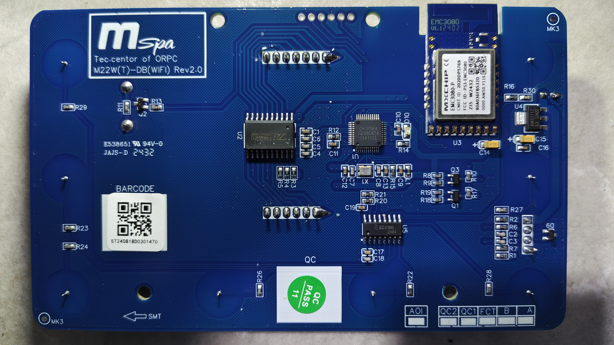

# MSpa Tribeca F-TR062W – lokální ovládání

> **🚧 IN PROGRESS / NOT FINISHED — projekt se vyvíjí, není dokončený ani připravený k běžnému provozu.**

[English](README.en.md) · [Dokumentace](docs/INDEX.md) · [Schéma a zapojení](docs/wiring/README.md)

Cílem je lokální ovládání vířivky MSpa Tribeca **F-TR062W** přes ESPHome a Home Assistant, při zachování původního ovládacího panelu. Cílová deska panelu je `M22W(T)-DB(WIFI) Rev2.0`. Projekt nepoužívá cloud MSpa.

## Aktuální stav

- Při pasivním odposlechu pomocí ESP32-C6 přicházely po zeleném vodiči rámce `A5 06 2C D7` a `A5 08 00 AD` na 9600 baudů, 8N1. Rámec `06 2C` odpovídal teplotě **22 °C** zobrazené na panelu; panel během testu fungoval.
- Červený vodič byl naměřen jako +5 V a bílý jako GND. Směr černého vodiče, skutečné úrovně datových signálů a úplná kompatibilita protokolu nejsou ověřeny.
- Aktivní obousměrné ovládání a chování po výpadku ESP32 dosud nejsou otestované. Původní panel musí zůstat funkční; hardwarový bypass zatím není navržen ani ověřen.

## Obsah

- [Zjištění, schéma a návrh zapojení](docs/wiring/README.md)
- [Pasivní test ESP32-C6](docs/wiring/esp32-c6-pasivni-test.md) · [testovací YAML](esphome/mspa-c6-pasivni-test.yaml)
- [Experimentální YAML pro ESP32-WROOM-32U](esphome/mspa-f-tr062w.yaml) · [návod k nastavení](docs/esphome-f-tr062w.cs-CZ.md)
- [Stav projektu a pokračování](docs/STAV.md)

**Konfigurace řadiče je experimentální.** Komponenta v současné podobě může zahazovat nerozpoznané rámce panelu a sama o sobě nezajistí funkci panelu při výpadku ESP32. Pro první pokusy nepoužívejte aktivní ovládání bez ověření komunikace a zapojení. Nenahrazuje bezpečnostní prvky vířivky.

## Původ a licence

Projekt vychází z [EtienneESP32/MSPA-ESP32-EEDOMUS](https://github.com/EtienneESP32/MSPA-ESP32-EEDOMUS). Zachováváme původní autorské uvedení a podmínky licence [MIT](LICENSE). Původní projekt a jeho dokumentace zůstávají dostupné na uvedeném odkazu.
