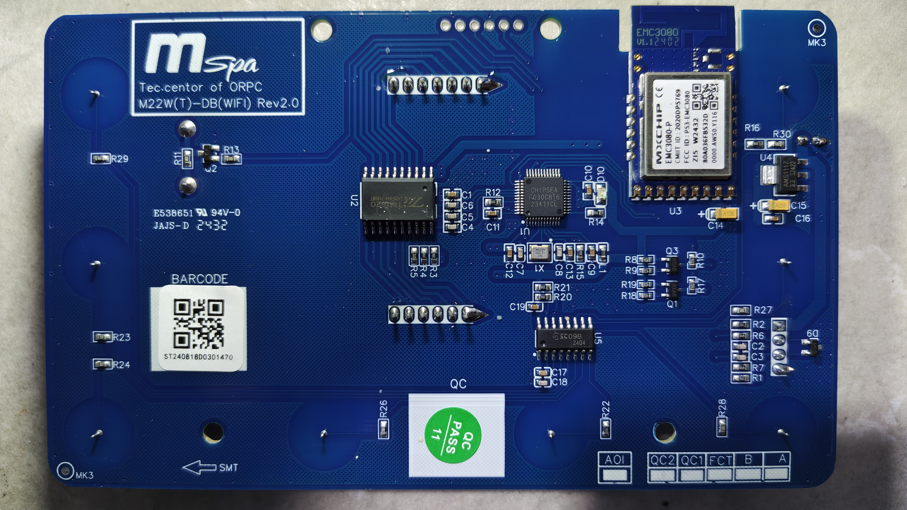
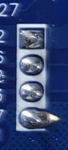

# Hardware a zapojení

[English](hardware.en.md) | [Původní francouzské schéma](hardware_schema.md) | [Seznam součástek](hardware_bom.md)

Původní projekt vkládá ESP32 mezi fyzický panel a řídicí jednotku vířivky. Dvě rozhraní UART předávají komunikaci oběma směry a umožňují lokální ovládání přes ESPHome. Původní panel zůstává připojený; z projektu však není prokázáno, že bude fungovat při zamrznutí či výpadku napájení ESP32. Požadované hardwarové přemostění je nutné samostatně navrhnout a ověřit.

## Referenční zapojení původního projektu

Autor uvádí tyto piny pro ESP32 DevKit V1 a firmware řadiče v6.3.6. **Nejde o ověřený pinout F-TR062W.** Před zapojením určete funkce konektoru a napěťové úrovně konkrétního zařízení.

| Signál | ESP32 | Směr |
| --- | --- | --- |
| TX vířivky | GPIO16 / RX2 | Vířivka → ESP32 |
| RX vířivky | GPIO17 / TX2 | ESP32 → vířivka |
| TX panelu | GPIO14 / RX1 | Panel → ESP32 |
| RX panelu | GPIO13 / TX1 | ESP32 → panel |

Původní zapojení používá převod úrovní pro své 5V signály. GPIO ESP32 nejsou tolerantní vůči 5 V. Napájení 5 V na konektoru nedokazuje napětí datových linek. Ověřte úrovně signálů a proudovou rezervu napájení, vyberte vhodný převodník pro UART a zkontrolujte zapojení i piny oproti skutečnému firmwaru. Nespojujte dva vysílací výstupy přímo dohromady.

## Poznatky o F-TR062W

Označení panelu je `M22W(T)-DB(WIFI) Rev2.0`; Wi-Fi modul je `MXCHIP EMC3080-P`. Vývody konektoru jsou na fotografiích číslovány shora dolů. Na panelu odpojeném od napájení naměřil majitel mezi pinem 4 a zápornou stranou C15 hodnotu 1,1 Ω, stejně jako při spojení sond. Pin 4 je tedy určen jako GND. Majitel také uvádí 5 V na konektoru, příslušný pin však dosud není určen. Funkce pinů 1–3 ani protokol nejsou ověřeny. Barvy ani pořadí vodičů z původního projektu nepřebírejte bez měření.

## Doporučený postup

1. Před rozebíráním a úpravou spojů odpojte zařízení od sítě. Zachovejte elektrické ochrany, izolaci a vodotěsnost.
2. Určete napájecí a oba signálové vodiče. Vhodným vybavením a za elektricky bezpečných podmínek změřte úrovně signálů a pasivně zaznamenejte oba směry komunikace při ovládání panelu.
3. Porovnejte zachycené rámce se snifferem a implementací původního projektu. Nejprve vyzkoušejte průchozí most bez vkládání příkazů.
4. Vyzkoušejte všechna tlačítka panelu, aktualizaci stavu i příkazy z HA a chování při výpadku napájení a selhání ESP32, Wi-Fi a HA. Případný hardwarový bypass ověřte samostatně.
