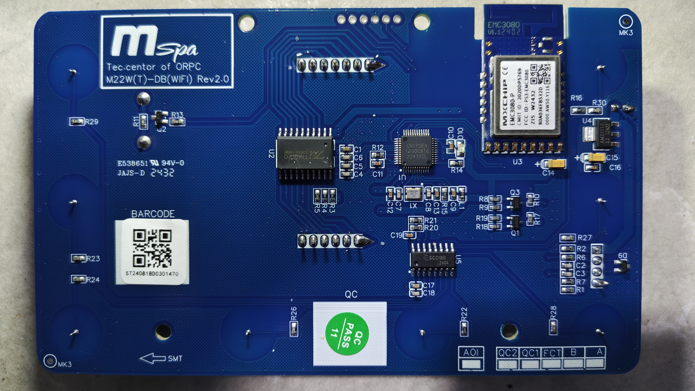
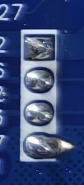

# Hardware and wiring

[Česky](hardware.cs-CZ.md) | [Original French wiring guide](hardware_schema.md) | [Bill of materials](hardware_bom.md)

The upstream design places an ESP32 between the original physical panel and spa controller. Two UART interfaces relay traffic in both directions and allow local control using ESPHome. The original panel remains connected; however, the original project does not establish that the panel remains operational if the ESP32 freezes or loses power. A fail-safe bypass must be designed and tested separately if required.

## Upstream reference wiring

The upstream guide lists the following pins for its ESP32 DevKit V1 and controller firmware v6.3.6. This is **not a verified pinout for the F-TR062W**. Determine connector functions and logic levels on the actual device before wiring.

| Signal | ESP32 | Direction |
| --- | --- | --- |
| Spa TX | GPIO16 / RX2 | Spa → ESP32 |
| Spa RX | GPIO17 / TX2 | ESP32 → spa |
| Panel TX | GPIO14 / RX1 | Panel → ESP32 |
| Panel RX | GPIO13 / TX1 | ESP32 → panel |

The upstream design uses level conversion for its 5 V signals. ESP32 pins are not 5 V tolerant. A 5 V supply on the connector does not establish the data-line voltage. Verify signal levels and the current capacity of the supply, select suitable UART-compatible conversion, and confirm all wiring and board pins against the actual firmware before connecting. Do not connect two transmitting outputs together.

## F-TR062W observations

Panel marking: `M22W(T)-DB(WIFI) Rev2.0`; Wi-Fi module: `MXCHIP EMC3080-P`. Connector pins are numbered from top to bottom in these photos. With the panel disconnected from power, the owner measured pin 4 to the negative terminal of C15 as 1.1 Ω, equal to the probes' shorted resistance. Pin 4 is consequently identified as GND. The owner also reports 5 V at the connector, but the relevant pin has not yet been identified. Pins 1–3 and the protocol remain unverified. Do not apply the upstream colour code or pinout without measurement.

## Suggested testing

1. Disconnect mains power before opening or modifying connections. Preserve electrical protection, insulation and waterproofing.
2. Identify supply and both signal wires. With suitable equipment and an electrically safe setup, measure signal levels and passively record both directions while operating the original panel.
3. Compare captured frames with the upstream sniffer and implementation. First test a transparent bridge with command injection disabled.
4. Test all panel controls, status updates and HA commands, plus loss of power and failures of the ESP32, Wi-Fi and HA. Verify the physical bypass separately if implemented.
