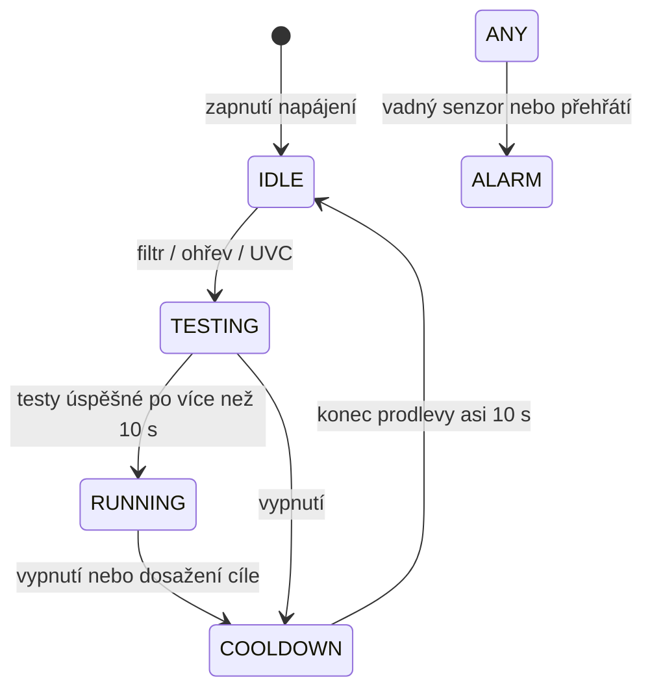
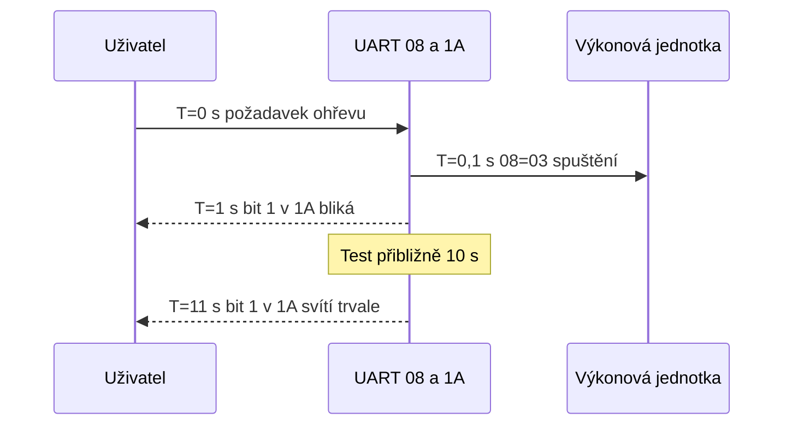

# Analýza protokolu MSpa v6.x

[English](mspa_full_reverse.en.md) · [Francouzský originál](mspa_full_reverse.md) · [Přehled](INDEX.md)

Překlad zjištění původního autora pro simulátor v1.6.0 a řadič v6.3.4. Nejde o ověření F-TR062W. Stavy, rámce a časování je třeba potvrdit odposlechem konkrétní jednotky.

## Průchod příkazu ohřevu

1. **Požadavek:** uživatel zvolí ohřev; panel → vířivka `A5 01 01 A7`.
2. **Akce:** jednotka sepne výkonová relé a odešle `A5 08 03 B0`; rozběhne čerpadlo a připraví relé ohřevu.
3. **Kontrola:** porovnává teplotu `06` s nastavením `1B:D2`, rámec `A5 1A 02 ..` se střídá s `08 ..` a symbol bliká.
4. **Provoz:** potvrzený rámec `A5 1A 02 ..`, symbol trvale svítí a ohřev běží.

## Vodní a vzduchový okruh

| Okruh | Prvky | Stav | Výkonový signál |
| --- | --- | --- | --- |
| Voda | čerpadlo, ohřev, UVC | `1A` stav, `06` teplota, `1B:D2` požadavek | `08` relé |
| Vzduch | dmychadlo bublinek | `1B:D1` úroveň, `12` přítomnost | — |

Bubliny tedy mohou běžet naplno bez oběhového čerpadla. Podle autora `0x08` sleduje vodní okruh, nikoli bubliny.

Po vypnutí ohřevu či UVC jednotka podle autora udržuje `0x08 = 03` asi 10 s kvůli dochlazení, přestože `1A` už hlásí připravenost `08`. Fyzický signál `08` může reagovat o několik milisekund před zobrazovacím rámcem `1A`.

## Stavy a časování

`IDLE` → `TESTING` po příkazu filtru, ohřevu nebo UVC; kontroluje se průtok a teplota. Po úspěšné kontrole (>10 s) následuje `RUNNING`. Vypnutí či dosažení cíle vede do `COOLDOWN`, přibližně po 10 s zpět do `IDLE`. Vadný senzor či přehřátí může vyvolat `ALARM`. Příklad autora: T=0 příkaz ohřevu, T=0,1 s `08=03`, T=1 s blikající bit 1 v `1A`, T=11 s trvalý bit jako potvrzení ohřevu. Úplné původní diagramy jsou v [originálu](mspa_full_reverse.md).

## Stavový diagram

Během IDLE je relé `08=00` a kontrolka připravenosti `1A:08`. TESTING má `08=03` a blikající `1A`; kontroluje průtok a stabilitu teploty. RUNNING má `08=03` a trvalou kontrolku. COOLDOWN ponechá `08=03` a vypne kontrolku `1A:08` kvůli dochlazení. ALARM používá specifické kontrolky (např. chyba F1).

## Příklad časové posloupnosti

## Přehled rámců jednotka → panel

| ID | Význam | Hodnota a chování podle autora |
| --- | --- | --- |
| `0x08` | Výkonové relé | `03` zapnuto / `00` vypnuto; reakce <200 ms |
| `0x1A` | Kontrolky | bit 0 filtr, bit 1 ohřev, bit 2 UVC; bliká při testu, trvale svítí při provozu |
| `0x1A` upozornění | Filtr | blikající bit 0 a `0x08 = 00`: symbol aktivní, motor vypnut |
| `0x06` | Skutečná teplota | hexadecimální hodnota, aktualizace každou sekundu |
| `0x1B` | Úroveň / nastavení | D1 bubliny, D2 požadovaná teplota; autor uvádí typ `int8_t` a podporu hodnot <30 °C |
| `0x12` | Dmychadlo | `01` přítomno, asynchronní heartbeat dvakrát za sekundu |
