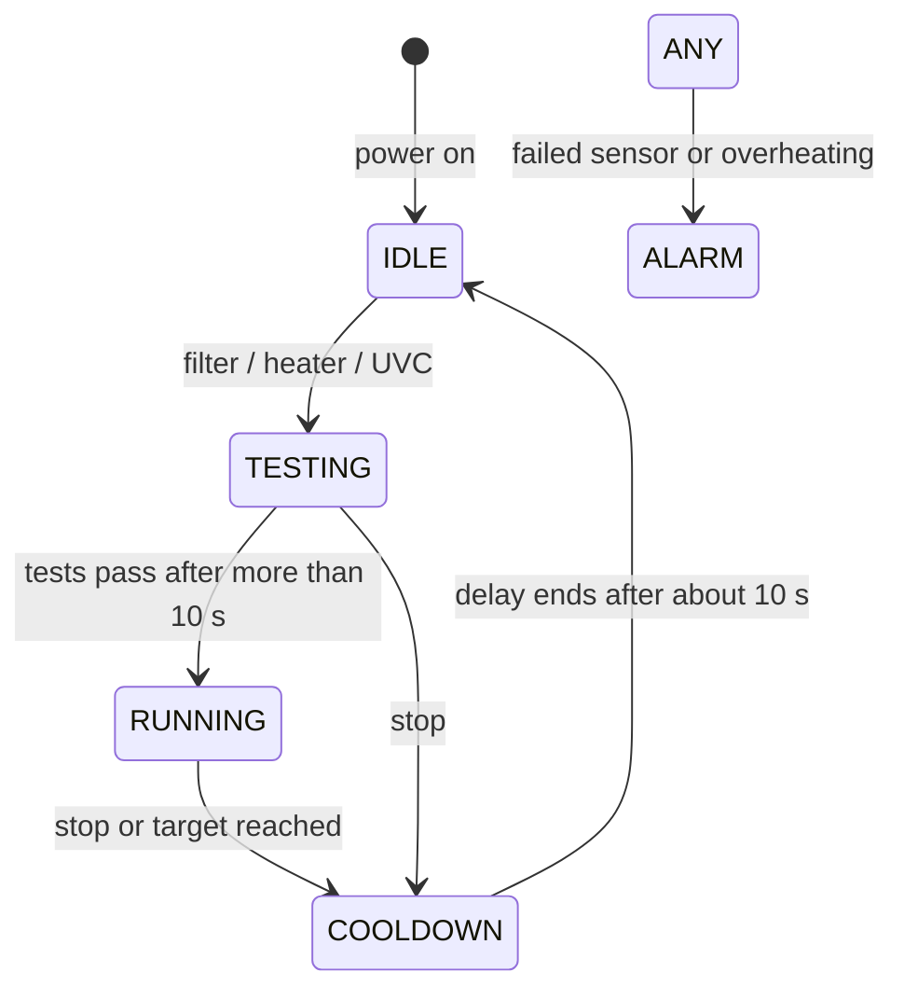
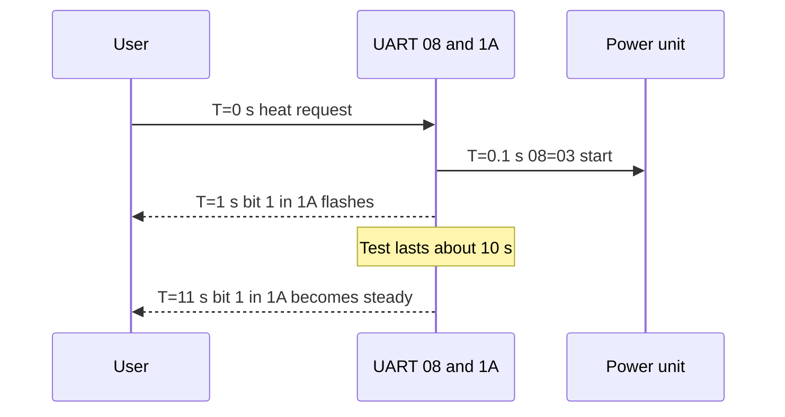

# MSpa protocol analysis v6.x

[Česky](mspa_full_reverse.cs-CZ.md) · [Original French](mspa_full_reverse.md) · [Index](INDEX.md)

Translation of the upstream author's findings for simulator v1.6.0 and controller v6.3.4. This does not verify the F-TR062W. Confirm its states, frames and timing through observation of the actual unit.

## Heating command lifecycle

1. **Intent:** the user selects heat; panel → spa `A5 01 01 A7`.
2. **Action:** the spa closes its power relays and sends `A5 08 03 B0`; the pump starts and heater relay is armed.
3. **Checks:** the spa compares temperature `06` with target `1B:D2`, `A5 1A 02 ..` alternates with `08 ..`, and the icon flashes.
4. **Running:** steady `A5 1A 02 ..`, steady icon and active heating.

## Water and air circuits

| Circuit | Components | Status | Physical signal |
| --- | --- | --- | --- |
| Water | pump, heater, UVC | `1A` status, `06` temperature, `1B:D2` target | `08` relay |
| Air | bubble blower | `1B:D1` level, `12` presence | — |

Bubbles can therefore run at full power while the circulation pump is off. The author associates `0x08` with the water circuit, not bubbles.

After heating or UVC stops, the author reports `0x08 = 03` for about 10 s for post-circulation even when `1A` has returned to ready (`08`). Physical signal `08` can precede the `1A` display frame by milliseconds.

## States and timing

`IDLE` → `TESTING` on filter, heater or UVC command; flow and temperature are checked. After successful checks (>10 s), enter `RUNNING`. Stop or reaching the target enters `COOLDOWN`, returning to `IDLE` after about 10 s. A faulty sensor or overheating may trigger `ALARM`. The author's example: T=0 heat command, T=0.1 s `08=03`, T=1 s flashing bit 1 in `1A`, T=11 s steady bit confirming heat. Full original diagrams are in the [source](mspa_full_reverse.md).

## State diagram

In IDLE relay `08=00` and ready indicator `1A:08`. TESTING uses `08=03` and flashing `1A` while checking flow and temperature stability. RUNNING has `08=03` and a steady indicator. COOLDOWN retains `08=03` with the indicator off (`1A:08`) for post-circulation. ALARM uses error-specific indicators such as F1.

## Example sequence

## Spa → panel frame reference

| ID | Meaning | Value and behaviour according to author |
| --- | --- | --- |
| `0x08` | Physical relay | `03` on / `00` off; response <200 ms |
| `0x1A` | Indicators | bit 0 filter, bit 1 heater, bit 2 UVC; flashes while testing, steady while running |
| `0x1A` alert | Filter | flashing bit 0 and `0x08 = 00`: icon active, motor off |
| `0x06` | Actual temperature | hex value, updated every second |
| `0x1B` | Level / target | D1 bubbles, D2 target temperature; author specifies `int8_t` and support below 30 °C |
| `0x12` | Blower | `01` present, asynchronous heartbeat twice per second |
