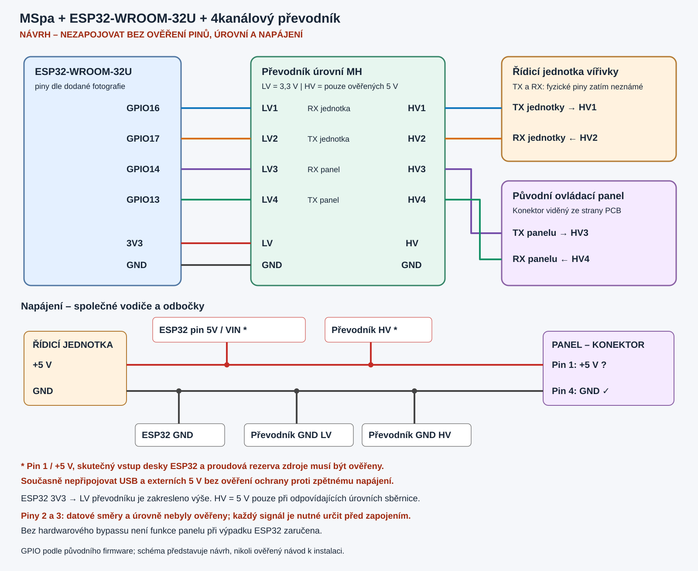

# Návrh zapojení ESP32-WROOM-32U a převodníku MH

[Zpět na přehled](../INDEX.md) · [Originální schéma projektu](../hardware_schema.md)

**Návrh není ověřený pro F-TR062W.** Nejde o schéma k okamžitému zapojení. ESP32 musí být při práci kolem otevřené vířivky bezpečně napájené a zařízení musí být před rozpojováním odpojené od sítě. Původní krytí a elektrické ochrany musí zůstat zachovány.

## Co víme a co ještě ověřit

- Číslování konektoru panelu je shora dolů podle fotografie: pin 4 byl ověřen jako GND měřením odporu. Pin 1 je podle majitele pravděpodobně +5 V; +5 V bylo naměřeno na volném protikonektoru, jeho vztah ke konkrétní plošce zatím není proměřen.
- Piny 2 a 3 jsou pravděpodobné datové linky. Není ověřeno, která je TX panelu, která RX panelu, ani zda je jejich úroveň 3,3 V nebo 5 V. Nepovažujte ani polaritu konektoru za ověřenou jen podle orientace obrázku.
- Před připojením převodníku k datovým linkám ověřte napětí, směr a zapojení konektoru. Pouhé prohození RX a TX bez znalosti výstupů může vést ke spojení dvou výstupů a zablokování nebo poškození. Multimetr nedokáže spolehlivě určit rychlé průběhy dat.
- Deska převodníku na fotografii odpovídá čtyřem MOSFET kanálům se zdvihovými odpory. [SparkFun popisuje použití podobného převodníku pro sériovou komunikaci](https://learn.sparkfun.com/tutorials/bi-directional-logic-level-converter-hookup-guide/all), ale to neověřuje tuto konkrétní desku či kompatibilitu se sběrnicí vířivky; ověřte i kvalitu hran a zatížení.

## Piny na konkrétních deskách

Na fotografii ESP32 s USB dole je **3V3** horní vlevo, **GND** vlevo mezi 12 a 13, **GPIO14 a GPIO13** vlevo, **GPIO16 a GPIO17** vpravo. Číslo na desce odpovídá GPIO. Na převodníku jsou jednotlivé páry `LV1/HV1`, `LV2/HV2`, `LV3/HV3`, `LV4/HV4`; páry spojují protilehlé napěťové strany, nikoliv sousední čísla. Každá strana má vlastní pin GND. V pohledu na fotku přední strany jsou zleva shora dolů `HV4, HV3, GND, HV, HV2, HV1`, zprava shora dolů `LV4, LV3, GND, LV, LV2, LV1`.

| Funkce | ESP32 | Převodník | Druhá strana |
| --- | --- | --- | --- |
| Příjem ze spa | GPIO16 | LV1 ↔ HV1 | TX řídicí jednotky |
| Vysílání do spa | GPIO17 | LV2 ↔ HV2 | RX řídicí jednotky |
| Příjem z panelu | GPIO14 | LV3 ↔ HV3 | TX panelu |
| Vysílání do panelu | GPIO13 | LV4 ↔ HV4 | RX panelu |
| Nízké napětí | 3V3 | LV | 3,3 V |
| Vysoké napětí | — | HV | ověřené napájení odpovídající logické úrovni, v tomto návrhu 5 V |
| Zem | GND | oba GND | společná ověřená GND jednotky i panelu |

Aktivní most vyžaduje rozdělení dvou datových cest; příslušné vodiče mezi panelem a jednotkou se neponechávají spojené přímo. Napájení a zem panelu zůstávají průchozí. Návrh nepřiřazuje TX a RX k pinům 2/3, protože to nebylo ověřeno. Při pasivním odposlechu naopak ponechte původní cesty neporušené a k signálům připojujte jen vstupy s vhodnou ochranou; nespojujte vysílací GPIO.

HV a LV převodníku jsou napájecí reference, nikoliv jednotlivé datové piny. Připojení ESP32 na 5V vodič je možné teprve po ověření vstupu konkrétní vývojové desky, proudové rezervy a bezpečnosti napájení; modul samotný není 5V zařízení. Zabraňte zpětnému napájení při současném USB a externím zdroji. Umístění antény ani plastová krabička samy o sobě nezajišťují vodotěsnost ani elektrickou bezpečnost.

Aktivní most může přerušit ovládání při zamrznutí, restartu nebo výpadku ESP32. Návrh neobsahuje automatický bypass ani watchdog bypassu. Před používáním je třeba vyzkoušet původní panel, ovládání, výpadky a bezpečnostní chování. Firmware `mspa-sniffer.yaml` v repozitáři data aktivně přeposílá a není čistě pasivní sniffer.

SVG je samostatný upravitelný soubor, který GitHub zobrazuje přímo. Není vytvořen v Cirkit Designeru a nejde o soubor tohoto nástroje; předpokládané funkce konektoru nejsou simulované ani ověřené.
