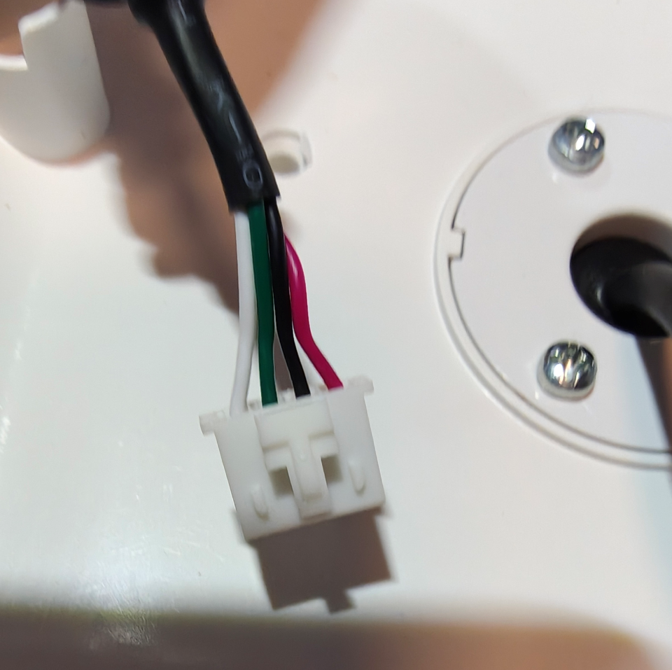

# Návrh zapojení ESP32-WROOM-32U a převodníku MH

[Zpět na přehled](../INDEX.md) · [Stav projektu](../STAV.md)

**Návrh není ověřený pro F-TR062W.** Nejde o schéma k okamžitému zapojení. ESP32 musí být při práci kolem otevřené vířivky bezpečně napájené a zařízení musí být před rozpojováním odpojené od sítě. Původní krytí a elektrické ochrany musí zůstat zachovány.

## Co víme a co ještě ověřit

- Číslování konektoru panelu je shora dolů podle fotografie: pin 4 byl ověřen jako GND měřením odporu. Pin 1 je podle majitele pravděpodobně +5 V; +5 V bylo naměřeno na volném protikonektoru, jeho vztah ke konkrétní plošce zatím není proměřen.
- Piny 2 a 3 jsou pravděpodobné datové linky. Není ověřeno, která je TX panelu, která RX panelu, ani zda je jejich úroveň 3,3 V nebo 5 V. Nepovažujte ani polaritu konektoru za ověřenou jen podle orientace obrázku.
- Před připojením převodníku k datovým linkám ověřte napětí, směr a zapojení konektoru. Pouhé prohození RX a TX bez znalosti výstupů může vést ke spojení dvou výstupů a zablokování nebo poškození. Multimetr nedokáže spolehlivě určit rychlé průběhy dat.
- Deska převodníku na fotografii odpovídá čtyřem MOSFET kanálům se zdvihovými odpory. [SparkFun popisuje použití podobného převodníku pro sériovou komunikaci](https://learn.sparkfun.com/tutorials/bi-directional-logic-level-converter-hookup-guide/all), ale to neověřuje tuto konkrétní desku či kompatibilitu se sběrnicí vířivky; ověřte i kvalitu hran a zatížení.

## Barvy vodičů konektoru od řídicí jednotky

Majitel naměřil **červený vodič +5 V** a **bílý GND**. Zelený a černý jsou zbývající kandidáti na datové vodiče; směr zeleného podporuje pasivní test níže, směr černého a napěťové úrovně obou linek zatím nejsou ověřeny. Na panelu je pin 4 ověřen jako GND, ale pořadí vodičů vůči pinům PCB ještě není potvrzeno proměřením.

**Výsledek pasivního testu:** Na zeleném vodiči připojeném k HV1 se přes LV1 a bílo-zelenou propojku k GPIO6 ESP32-C6 při 9600 8N1 opakovaně přijímá `A5 06 2C D7` a `A5 08 00 AD`. Oba rámce mají platný součtový kontrolní součet. V původním projektu znamená `06 2C` teplotu 22,0 °C. Panel během testu fungoval a ukazoval 22 °C. To silně podporuje směr řídicí jednotka → panel; napěťové úrovně a směr černého vodiče zatím čekají na ověření.

Jiný model [MSpa Aurora Urban U-AU062 v projektu johannesc/mspa-wifi](https://github.com/johannesc/mspa-wifi#control-box) má stejné barvy a autor u něj uvádí zelený jako TX jednotky a černý jako RX jednotky. To je vodítko, ne důkaz pro F-TR062W. Následující přiřazení je tedy **hypotéza – nepřipojovat jako ověřené zapojení**:

| Předpokládaný směr | Konec kabelu | Kanál převodníku | ESP32 |
| --- | --- | --- | --- |
| Jednotka → ESP32 | zelený ze strany jednotky; pasivně zachyceny stavové rámce | HV1 ↔ LV1 | GPIO16 RX / při testu C6 GPIO6 RX |
| ESP32 → jednotka | černý ke straně jednotky | HV2 ↔ LV2 | GPIO17 TX |
| Panel → ESP32 | černý od panelu | HV3 ↔ LV3 | GPIO14 RX |
| ESP32 → panel | zelený k panelu | HV4 ↔ LV4 | GPIO13 TX |

Tabulka předpokládá, že zelený a černý vodič zůstanou barevně souhlasně propojeny až k panelu a datové vodiče budou pro aktivní most rozděleny na dva oddělené konce. To vše je nutné ověřit. **Na samotném konektoru od jednotky pro první pasivní test patří k jednotce pouze HV1 a případně HV2; HV3 a HV4 jsou na straně panelu až při vytvoření průchozího mostu.** Při pasivním testu propojení panel–jednotka zůstává neporušené a ESP32 nesmí vysílat do vodiče.

### Křížová kontrola proti procesoru

Procesor U1 je podle označení `F030C8T6` pravděpodobně CHIPSEA CS32F030C8T6 v pouzdru LQFP48. Podle [datasheetu CS32F030](https://crossic.com/wp-content/uploads/2021/12/CS32F030%E6%95%B0%E6%8D%AE%E6%89%8B%E5%86%8C_%E4%B8%AD%E6%96%87V1.5_1635504881662.5.pdf) může být nožička 30 (`PA9`) použita jako `USART1_TX` a nožička 31 (`PA10`) jako `USART1_RX`. To jsou alternativní funkce: není prokázáno, že je firmware panelu takto používá nebo že jsou přímo spojené s konektorem. Při měření s vypnutým a odpojeným panelem lze porovnat odpory mezi oběma datovými piny konektoru a nožičkami procesoru; sériový odpor nebo tranzistor může způsobit, že se přímé spojení neprokáže. Silnou indicii poskytne spojení vodiče s danou nožičkou **a** ověření konfigurace či skutečného průběhu signálu. Nepovažovat samotný datasheet ani nepípající měření za potvrzení TX/RX.

## Piny na konkrétních deskách

Na fotografii ESP32 s USB dole je **3V3** horní vlevo, **GND** vlevo mezi 12 a 13, **GPIO14 a GPIO13** vlevo, **GPIO16 a GPIO17** vpravo. Číslo na desce odpovídá GPIO. Na převodníku jsou jednotlivé páry `LV1/HV1`, `LV2/HV2`, `LV3/HV3`, `LV4/HV4`; páry spojují protilehlé napěťové strany, nikoliv sousední čísla. Každá strana má vlastní pin GND. V pohledu na fotku přední strany jsou zleva shora dolů `HV4, HV3, GND, HV, HV2, HV1`, zprava shora dolů `LV4, LV3, GND, LV, LV2, LV1`.

| Funkce | ESP32 | Převodník | Druhá strana |
| --- | --- | --- | --- |
| Příjem ze spa | GPIO16 | LV1 ↔ HV1 | TX řídicí jednotky |
| Vysílání do spa | GPIO17 | LV2 ↔ HV2 | RX řídicí jednotky |
| Příjem z panelu | GPIO14 | LV3 ↔ HV3 | TX panelu |
| Vysílání do panelu | GPIO13 | LV4 ↔ HV4 | RX panelu |
| Nízké napětí | 3V3 | LV | 3,3 V |
| Vysoké napětí | — | HV | ověřené napájení odpovídající logické úrovni, v tomto návrhu 5 V |
| Zem | GND | oba GND | společná ověřená GND jednotky i panelu |

Aktivní most vyžaduje rozdělení dvou datových cest; příslušné vodiče mezi panelem a jednotkou se neponechávají spojené přímo. Napájení a zem panelu zůstávají průchozí. Návrh nepřiřazuje TX a RX k pinům 2/3, protože to nebylo ověřeno. Při pasivním odposlechu naopak ponechte původní cesty neporušené a k signálům připojujte jen vstupy s vhodnou ochranou; nespojujte vysílací GPIO.

V napájecí části schématu je průběžný 5V vodič mezi jednotkou a panelem s odbočkami na **HV převodníku** a na předpokládaný **5V/VIN vstup vývojové desky**. Druhý průběžný vodič je GND s odbočkami na GND ESP32 a oba GND převodníku. Na snímku je u spodního levého pinu ESP32 označení `5V`; jeho skutečné zapojení jako vstupu je nutné před použitím ověřit. Pin 1 panelu je stále pouze předpokládaných +5 V.

HV a LV převodníku jsou napájecí reference, nikoliv jednotlivé datové piny. Připojení ESP32 na 5V vodič je možné teprve po ověření vstupu konkrétní vývojové desky, proudové rezervy a bezpečnosti napájení; modul samotný není 5V zařízení. Zabraňte zpětnému napájení při současném USB a externím zdroji. Umístění antény ani plastová krabička samy o sobě nezajišťují vodotěsnost ani elektrickou bezpečnost.

Aktivní most může přerušit ovládání při zamrznutí, restartu nebo výpadku ESP32. Návrh neobsahuje automatický bypass ani watchdog bypassu. Před používáním je třeba vyzkoušet původní panel, ovládání, výpadky a bezpečnostní chování. Pro pasivní odposlech použijte pouze samostatný [testovací YAML pro ESP32-C6](../../esphome/mspa-c6-pasivni-test.yaml), který nemá datový TX.

SVG je samostatný upravitelný soubor, který GitHub zobrazuje přímo. Není vytvořen v Cirkit Designeru a nejde o soubor tohoto nástroje; předpokládané funkce konektoru nejsou simulované ani ověřené.
