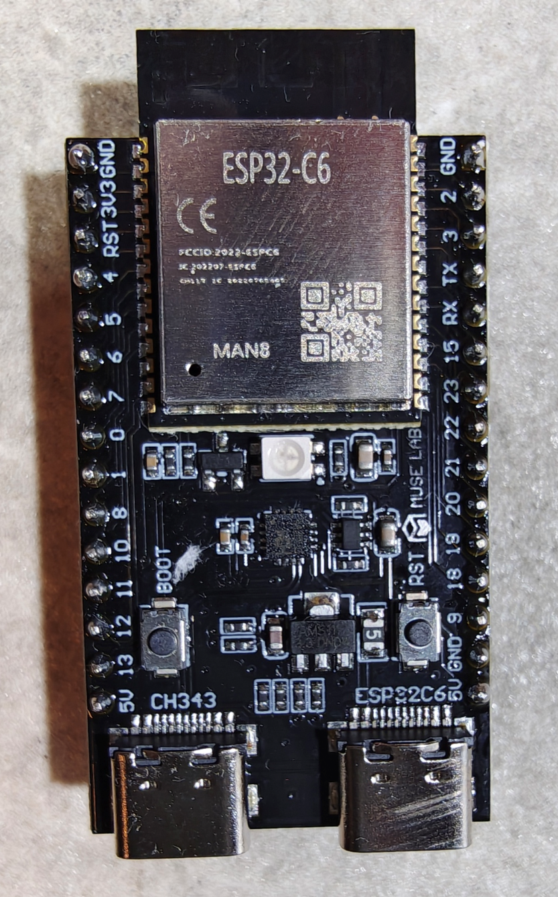

# První pasivní test s ESP32-C6

Deska podle vzhledu odpovídá MuseLab nanoESP32-C6 s levým USB-C `CH343` a pravým USB-C `ESP32C6`. Pro níže uvedený test použijte samostatnou konfiguraci [mspa-c6-pasivni-test.yaml](../../esphome/mspa-c6-pasivni-test.yaml). Je určena jen k příjmu, GPIO6 je jediné připojení dat k ESP32; žádný vysílací pin UART není konfigurován. Rychlostí 9600 8N1 byly na zelené lince zachyceny platné rámce odpovídající teplotě 22 °C na panelu.

## Před připojením

- Odpojte vířivku i USB. Vyjměte poškozené ESP32. Zkontrolujte patici a převodník, zda nedošlo k poškození. Multimetrem na Ω změřte mezi GND a 3V3 i mezi GND a 5V v patici; hodnoty pomohou hledat zkrat, samy o sobě nepotvrzují správné zapojení.
- U paticového kontaktu zamýšleného jako RX ověřte spojitost s LV1 převodníku; u GND a 3V3 ověřte odpovídající spojitost se zemí a LV. **Neřiďte se pouhou polohou zásuvky** po předchozím opačném zasunutí.
- Zelený vodič při pasivním testu přenášel stavové rámce a teplotu shodnou s panelem, což silně podporuje směr jednotka → panel. Napětí ani typ signálů u F-TR062W nebyly ověřeny. Použití konkrétního převodníku MH a jeho 5V pull-up na dosud neznámé datové lince není potvrzené; nejdříve je nutno zjistit úrovně a vhodné napájení jeho HV strany.
- Původní panel zůstává přímo připojený k řídicí jednotce. Při pasivním testu se vodič nepřerušuje. Nepřipojujte TX z ESP32.

## Propojky až po ověření

| Ověřený signál v původní patici / převodníku | ESP32-C6 | Účel |
| --- | --- | --- |
| GND | GND | společná zem nízkonapěťových obvodů |
| LV převodníku (původně 3V3) | 3V3 | 3,3V reference převodníku |
| LV1 převodníku (původně GPIO16) | GPIO6 | pouze příjem |

HV1 by sledoval ověřený datový vodič řídicí jednotky. HV je napájecí reference převodníku a její napětí musí odpovídat ověřené lince; nespoléhat se jen na naměřených 5 V napájení panelu. Ostatní datové kanály zůstanou nezapojené. Pokud by propojení zdrojů nebo izolace nízkonapěťové části nebyly jasné, nezapojujte měřicí nebo USB zařízení, dokud není napájení bezpečně ověřené.

## Samostatná zkouška ESP32

Nejprve nahrajte konfiguraci s deskou mimo patici a bez spojení s vířivkou, pouze přes pravé nativní USB-C `ESP32C6`. Konfigurace směruje log přes `USB_SERIAL_JTAG`, používá stejné názvy Wi-Fi a bezpečnostních secrets jako původní lokální YAML a vytváří samostatné zařízení `mspa-c6-test`. Žádný očekávaný výstup UART bez připojeného datového signálu není. Nepřipojujte současně USB a 5V z vířivky bez vyřešeného zpětného napájení.

Při dosavadním testu byly na zelené lince při 9600 8N1 zachyceny rámce A5 06 2C D7 a A5 08 00 AD; 22 °C odpovídalo panelu. Po ověření všech bodů výše, za podmínek elektrické bezpečnosti a se správně napájeným převodníkem lze pokračovat v odposlechu. V logu budou hexadecimální bajty přijímané na GPIO6. Přítomnost dat ani rámce podobného `A5` sama o sobě neprokazuje úplnou kompatibilitu. Pokud nic nepřijde, nepovažujte to automaticky za závadu zařízení: může být jiný vodič, logická úroveň, rychlost nebo protokol.
